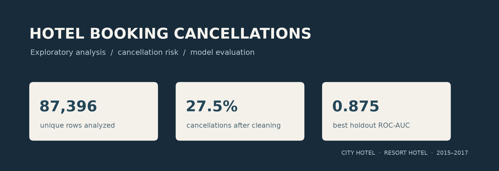
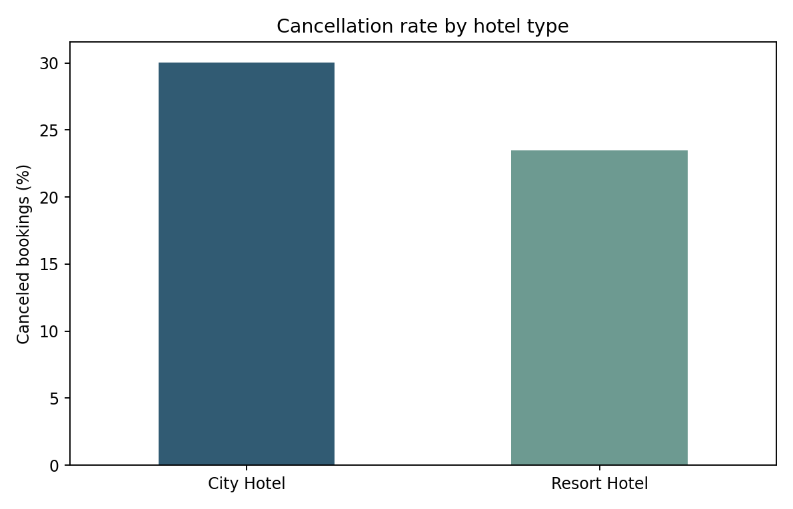
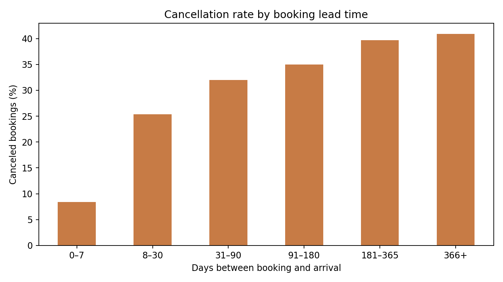
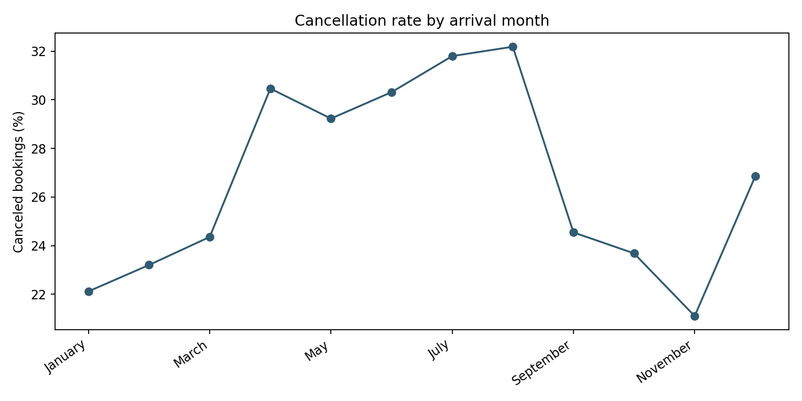

<p align="center">
  
</p>

## My contribution

I wrote the project code for the booking data analysis and cancellation modeling, then documented the results and how to run the project.

# ????? ?????? ??????? ????????

????? ??????? ?????? ???? ????? ??????? ?? ?????? ????? ??? ??????? ?????? ???????? ???????.

## ???? ???????

| ?????? | ??????? |
|---|---:|
| ??? ??????? ?? ????? ?????? | 119,390 |
| ??????? ??? ????? ?????? ????????? | 87,396 |
| ?????? ????????? ??????? | 31,994 |
| ???? ??????? ??? ??????? | 27.5% |

??? ???? ??????? 30.0% ?? City Hotel ?23.5% ?? Resort Hotel. ???? ???? ?????? ??? ????? ??????? 80 ????? ???????? ??????? ?38 ????? ???????? ????????.

### ?????? ???????

| ??????? | ROC-AUC | Precision | Recall | F1 |
|---|---:|---:|---:|---:|
| Logistic Regression | 0.856 | 0.550 | 0.810 | 0.655 |
| Random Forest | 0.875 | 0.539 | 0.849 | 0.659 |

??? Random Forest ???? ROC-AUC ?????? ??????? ????? ???? ???? ??????? ????? ???? ?? Logistic Regression. ??????? ??? ????? ???????? ???????? ?? ??????? ??? ???? ?????? ??? ?????? ?????.

## ??????

<p align="center">
  
  
  
</p>

## ????? ?????

- ????? ????? ??????? ??? ???? ????? ????????? ???????? ???? `company` ????? ????? ???????? ???.
- ???????? ????? ???? ????? ????? ??? ??????? ??? `reservation_status` ???????.
- ????? ?????? ????????? ??? ????? ????????. ?? ????? ?????? ??? ????? ???? ???? ?? ???? ??? ?????? ????????? ?????? ??????? ????? ??????? ??? ??? ??????.
- ??????? ????? ???? ?????? ????? 75/25 ????? ?????.

## ??????? ????????

- [??????? ??????](hotel-bookings-analysis/reports/report.md) ? [???? HTML](hotel-bookings-analysis/reports/report.html)
- [????????](hotel-bookings-analysis/reports/metrics.json) ? [??? ???????](hotel-bookings-analysis/src/analyze.py)
- [??????? ???????](hotel-bookings-analysis/README.md)

?????? ??????? ??????? ???? Python 3.10 ?? ????:

```bash
cd hotel-bookings-analysis
python -m venv .venv
# Windows: .venv\Scripts\activate
# macOS/Linux: source .venv/bin/activate
pip install -r requirements.txt
python src/analyze.py
```

## ???? ????????

[Hotel Booking Demand dataset](https://doi.org/10.1016/j.dib.2018.11.126)? ???? ????? ?????? ????? ????? ?????? ?? ????????.

Python ? Pandas ? Scikit-learn ? Matplotlib
