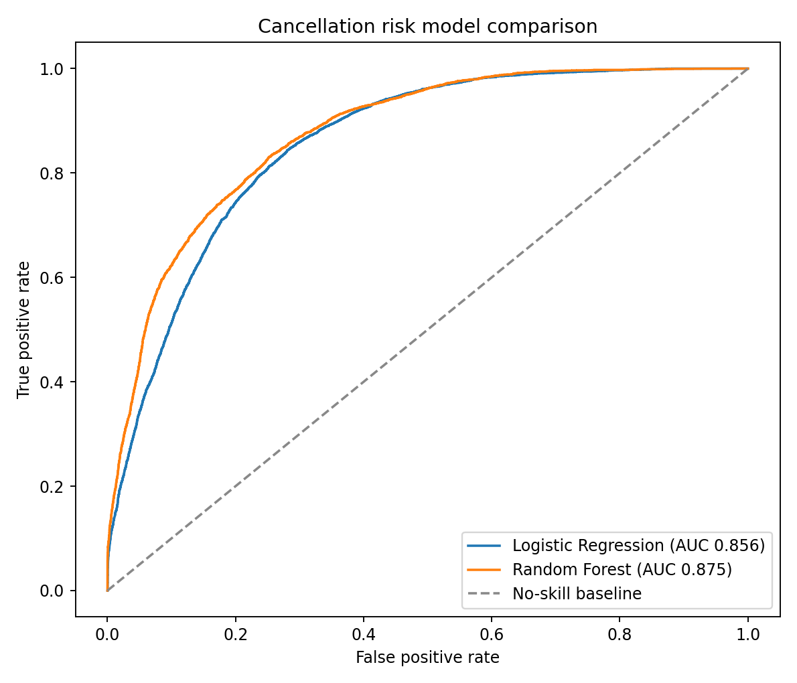
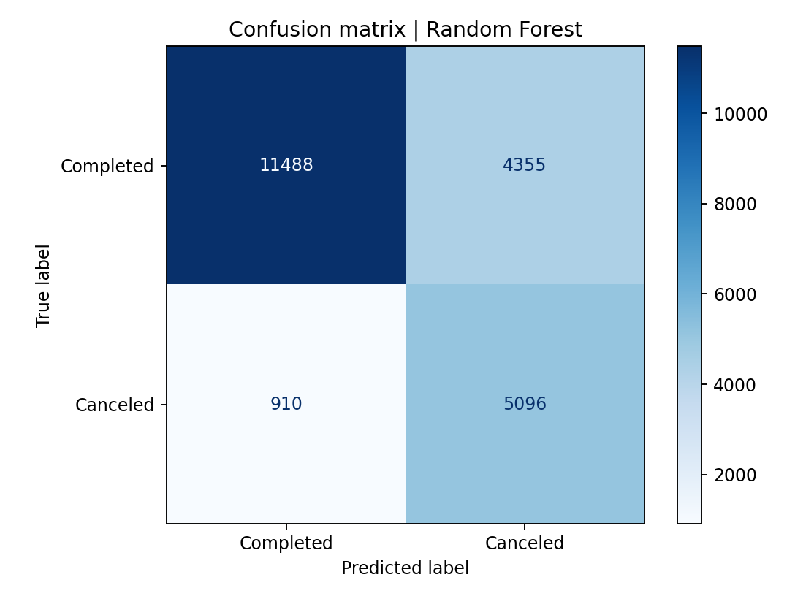
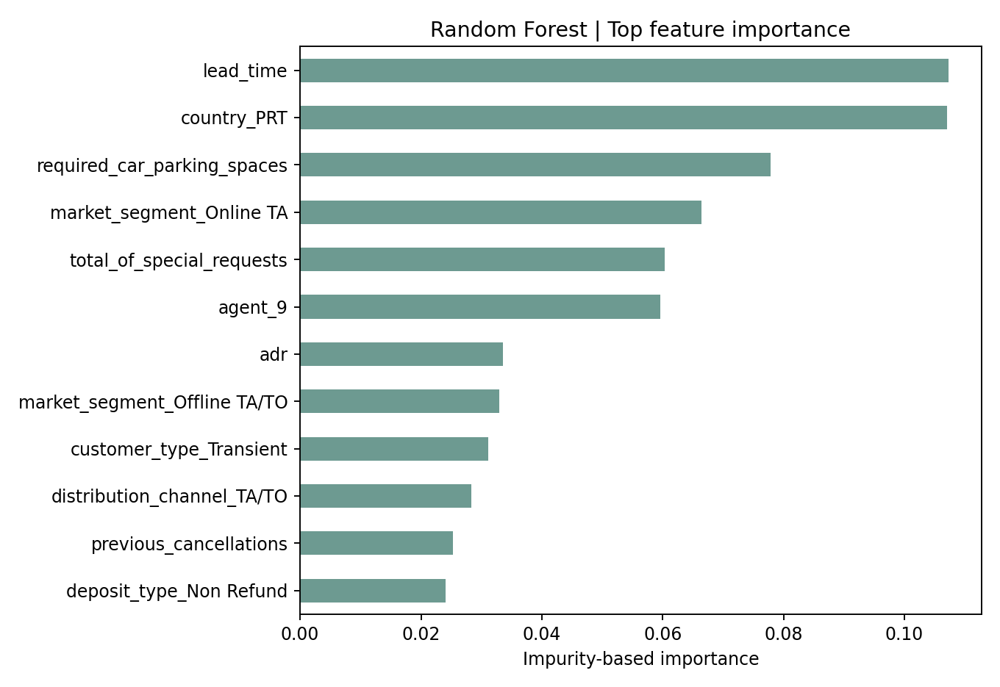

# إلغاءات الحجوزات الفندقية

## ملخص

حللت بيانات حجوزات City Hotel وResort Hotel، ثم قارنت نموذجين لتقدير احتمال إلغاء الحجز. بعد حذف الصفوف المتطابقة بالكامل، سجل Random Forest أفضل نتيجة تمييزية في الاختبار: **ROC-AUC = 0.875**. وعند عتبة التصنيف الافتراضية 0.5، استعاد النموذج **84.9%** من الحجوزات الملغاة، وكانت **53.9%** من الحجوزات التي صنفها كملغاة ملغاة بالفعل.

هذه نتائج استكشافية على تقسيم عشوائي واحد. لا ينبغي اعتبارها أداءً مضمونًا على حجوزات مستقبلية.

## البيانات والتنظيف

يتضمن الملف **119,390 صفًا و32 عمودًا**. وُجدت **31,994** صفوف متطابقة تمامًا عبر جميع الأعمدة. أزيلت هذه الصفوف قبل تقسيم التدريب والاختبار كي لا تظهر نسخ متطابقة من السجل نفسه على جانبي التقسيم. بقي **87,396** سجلًا: **63,371** حجزًا غير ملغى و**24,025** ملغى.

تغيّر معدل الإلغاء من **37.0%** في الملف الخام إلى **27.5%** بعد إزالة التكرارات. لا يتضمن الملف معرّفًا فريدًا للحجز، لذلك لا يمكن التأكد إن كان كل صف متطابق نسخة مكررة أو حجزًا مستقلًا بالتفاصيل ذاتها. هذا القرار يؤثر بوضوح في معدلات الإلغاء وفي تعميم نتائج النموذج.

عولجت القيم الناقصة في `children` و`country` و`agent` داخل مسار تجهيز البيانات. حُذف عمود `company` من النموذج لاحتوائه على قيم مفقودة في معظم السجلات. أما الصفوف المتطابقة فأزيلت قبل التدريب كما سبق توضيحه.

## ما يظهر في البيانات

- بعد إزالة التكرارات، بلغ معدل الإلغاء **30.0%** في City Hotel و**23.5%** في Resort Hotel.
- كان وسيط الفترة بين الحجز والوصول **80 يومًا** للحجوزات الملغاة، مقابل **38 يومًا** للحجوزات المكتملة.
- بلغ متوسط الطلبات الخاصة **0.54** للحجوزات الملغاة و**0.76** للمكتملة.
- أظهرت الحجوزات المصنفة `Non Refund` معدل إلغاء مرتفعًا (**94.7%**) ضمن 1,038 سجلًا. هذه علاقة وصفية في العينة، وتحتاج إلى فهم سياسة البيانات قبل تفسيرها تشغيليًا.

## النماذج والتقييم

استخدمت تقسيمًا طبقيًا عشوائيًا بنسبة 75/25، مع `random_state=42`. درّبت Logistic Regression وRandom Forest بعد تعويض القيم الناقصة، وتوحيد المقاييس الرقمية، وترميز المتغيرات الفئوية. استُبعدت `reservation_status` و`reservation_status_date` لأنها تسجل النتيجة بعد وقوعها، كما استُبعدت `assigned_room_type` و`booking_changes` لتجنب استخدام معلومات قد لا تكون متاحة عند الحجز.

| النموذج | ROC-AUC | Average precision | Accuracy | Precision | Recall | F1 |
|---|---:|---:|---:|---:|---:|---:|
| Logistic Regression | 0.856 | 0.671 | 0.766 | 0.551 | 0.810 | 0.656 |
| Random Forest | **0.875** | **0.729** | 0.759 | 0.539 | **0.849** | **0.659** |

اختير Random Forest حسب ROC-AUC. دقته الإجمالية أقل قليلًا من Logistic Regression، لكنه يلتقط نسبة أكبر من حالات الإلغاء. في تطبيق عملي، ينبغي ضبط عتبة القرار وفق تكلفة التواصل مع عميل لن يلغي الحجز، وتكلفة عدم اكتشاف حجز معرض للإلغاء.

## حدود الاستخدام

التقييم عشوائي وليس زمنيًا؛ لذا قد يكون متفائلًا عند استخدامه للتنبؤ بفترة مستقبلية. كما أن بيانات الحجوزات لا تتضمن معرّفًا أو معلومات تعريف شخصية، ولا تمثل بالضرورة سياسات التشغيل الحالية لأي فندق. أهمية الخصائص تصف مساهمة النموذج في هذا التقسيم، ولا تثبت أن أي عامل يسبب الإلغاء.

## المصدر

Antonio, N., de Almeida, A., & Nunes, L. (2019). [Hotel booking demand datasets](https://doi.org/10.1016/j.dib.2018.11.126), *Data in Brief*, 22, 41–49.
